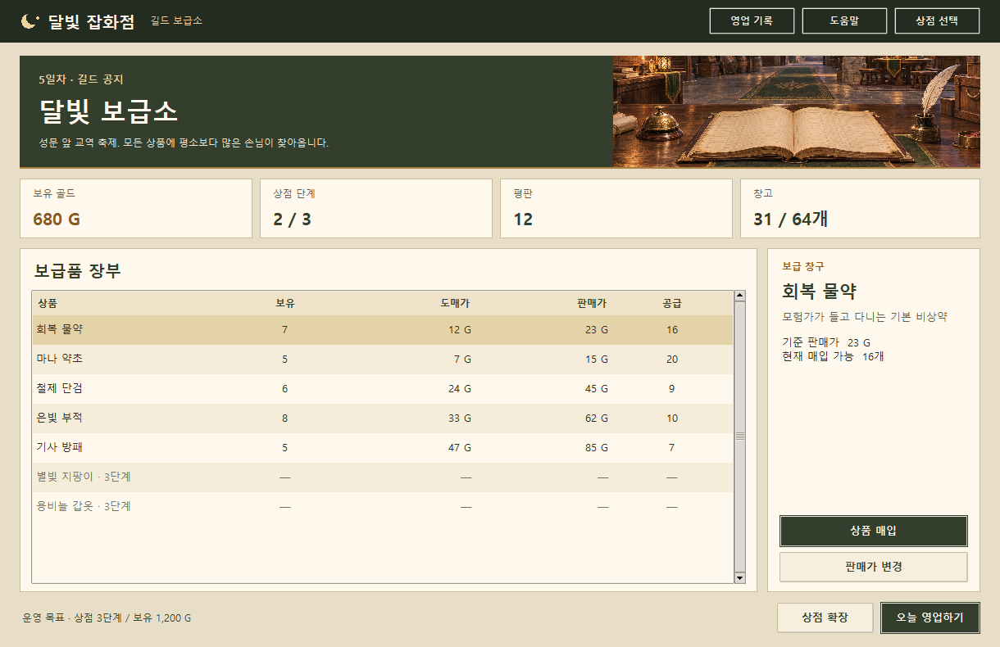

# 달빛 잡화점

파이썬과 MySQL로 만든 한국어 데스크톱 게임입니다. 모험가 길드의 보급 담당자가 되어 물약, 무기, 마법 도구를 매입하고, 가격을 정해 보급 창구에서 판매하세요.

**목표는 상점 3단계와 보유 골드 1,200 G입니다.** 처음에는 220 G와 기본 상품 14개가 주어집니다. 목표를 달성한 뒤에도 계속 영업할 수 있습니다.



## Windows에서 실행하기

### MySQL 없이 체험하기

`shop_gui.py`를 실행한 후 **MySQL 없이 체험하기**를 누르면 데이터베이스 설치 없이
상품 매입, 판매가 변경, 영업 정산, 상점 확장을 모두 플레이할 수 있습니다.
체험 데이터는 실행 중 메모리에만 보관되며 게임을 종료하거나 처음 화면으로 돌아가면 사라집니다.
기존 MySQL 모드는 그대로 유지되며 DB 모드의 기록에는 영향을 주지 않습니다.
Windows EXE는 이 기능을 포함하여 **다시 빌드해야** 합니다.

### 실행 파일

1. MySQL Server 8.0 이상을 실행하고 `FantasyShop.exe`를 엽니다.
2. 연결 창에서 MySQL 계정과 비밀번호를 입력한 뒤 **연결하기**를 누릅니다. 로컬 MySQL의 기본 주소는 `127.0.0.1:3306`입니다.
3. 처음 실행해 게임 테이블이 없다면 MySQL 관리자 계정으로 **데이터베이스 초기화**를 누릅니다. 기본 데이터베이스 이름은 `fantasy_shop`입니다.
4. 새 상점을 열거나 저장한 상점을 불러옵니다.

기존 `fantasy_shop` 저장 데이터는 같은 연결 정보로 불러올 수 있습니다. 별도 게임 계정을 쓰는 경우 초기화된 데이터베이스에 대한 `SELECT`, `INSERT`, `UPDATE` 권한이 필요합니다.

### 파이썬 소스 실행

Python 3.10 이상이 필요합니다. 압축을 풀고 PowerShell에서 `shop_gui.py`가 있는 폴더로 이동한 뒤 실행하세요.

```powershell
python -m venv .venv
.\.venv\Scripts\python.exe -m pip install -r requirements.txt
.\.venv\Scripts\python.exe shop_gui.py
```

MySQL에서 `schema.sql`을 직접 적용해 데이터베이스를 만들 수도 있습니다. 같은 SQL을 다시 적용해도 기존 저장 데이터가 유지됩니다.

## 플레이 방법

1. 길드 공지와 보급품 장부에서 오늘의 수요와 재고, 도매가를 살핍니다.
2. 상품을 선택하고 **상품 매입**이나 **판매가 변경**을 누릅니다.
3. **오늘 영업하기**를 누르면 손님이 찾아옵니다. 판매 내역을 정산하고 다음 날로 넘어갑니다.
4. **영업 기록**에서 최근 7일의 매출과 이익을 확인합니다. 평판과 자금이 충분하면 **상점 확장**을 누릅니다.

기준가는 손님이 기대하는 가격의 참고값입니다. 가격을 올리면 한 개를 팔 때 더 벌지만, 구매하는 손님이 줄 수 있습니다. 모험가 길드 출정일에는 무기와 회복 물약 수요가 늘고, 대상단이 오면 도매가가 내려갑니다. 당일 소식에 맞춰 매입하세요.

매입, 가격 변경, 영업, 확장은 완료 시점마다 MySQL에 저장됩니다. 매입할 때 골드가 차감되고, 영업 보고서의 이익은 매출에서 **판매된 수량에 해당하는 매입 원가**를 뺀 값입니다. 재고에 남은 상품의 원가는 이후 판매 시 반영됩니다.

## 파일 구성

| 파일 | 역할 |
|---|---|
| `shop_gui.py` | 데스크톱 화면, 보급 장부와 연결 설정 |
| `shop_dialogs.py` | 매입, 가격 변경, 정산, 도움말 창 |
| `game.py` | 터미널 실행용 메뉴 |
| `shop.py` | 판매와 확장 규칙, MySQL 연결과 트랜잭션 |
| `guest_store.py` | MySQL 없이 게임을 진행하는 체험 모드(메모리 저장) |
| `schema.sql` | 상품 초기 데이터, 상점·재고·거래·일별 결산 테이블 |
| `requirements.txt` | Python용 MySQL 드라이버 |

## 삽화

보급 창구 삽화는 기본 이미지 생성 도구로 만들었습니다. 그림에는 중세 모험가 길드의 목조 접수대, 펼친 양피지 장부, 황동 종과 깃펜, 금빛 초승달이 달린 녹색 깃발, 촛불과 격자창을 담았습니다. [삽화 파일](assets/shop-illustration.png)
